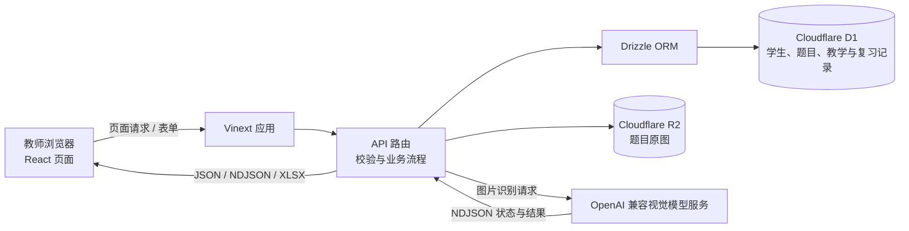
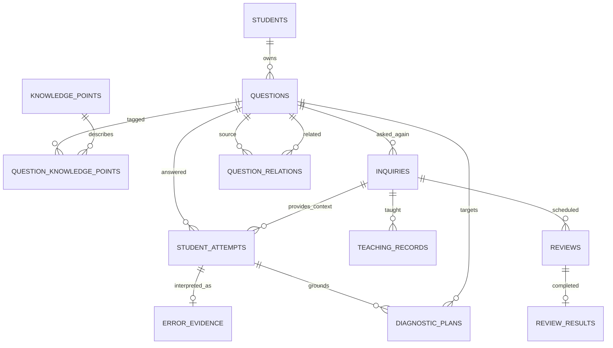
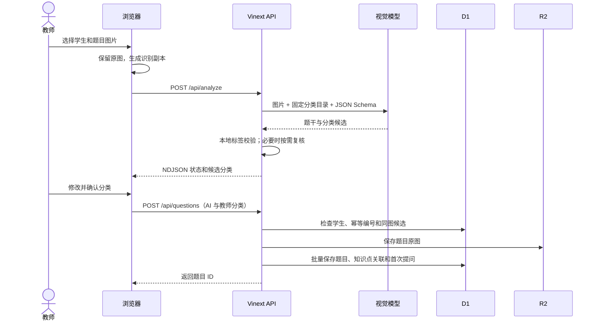
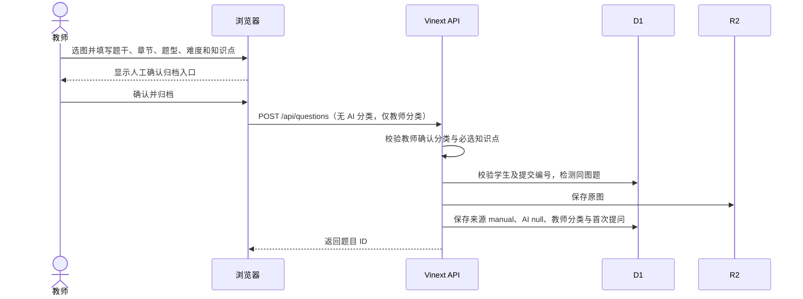

# 系统设计说明

## 1. 设计目标与范围

系统服务于中学数学家教的日常工作，将学生、题目、教师确认分类、授课和复习记录关联起来。设计优先保证记录可追溯、失败可恢复、题目分类可由教师校正。

本系统不自动判定学生掌握程度，不把 AI 输出当作最终分类，也不从题目出现频次推导学习效果。当前版本用于本机演示和单用户开发；登录、教师身份及多租户隔离仍未实现，不能作为公网生产系统使用。

## 2. 总体架构

前端负责图片预览和识别副本预处理、教师分类编辑及学习记录录入。API 路由执行输入校验、目录规则校验、重复题判断、数据持久化和导出。D1 保存可查询的结构化数据，R2 保存题目原图；AI 服务仅返回待教师确认的题干与分类建议。

## 3. 模块与接口

| 模块 | 主要接口 | 责任 |
| --- | --- | --- |
| 学生档案 | `GET/POST /api/students`；`GET/PATCH/DELETE /api/students/[id]` | 档案管理、学生详情、软删除 |
| 题目识别 | `POST /api/analyze`；`POST /api/analyze/cancel` | 图片约束检查、上游模型调用、分类校验、状态流、取消 |
| 题目录入 | `POST /api/questions`；`PATCH/DELETE /api/questions/[id]` | 教师确认、分类来源、图片存储、幂等和同图处理 |
| 学习追踪 | `GET/POST /api/students/[id]/learning` | 提问、教学、复习计划、复习结果及历史查询 |
| 教学智能体 | `GET/POST/PATCH /api/students/[id]/agent/diagnostics` | 生成、保存、采用或放弃诊断方案；方案与真实作答分离 |
| 数据导出 | `GET /api/students/[id]/export` | 单学生 XLSX、日期范围过滤、公式文本安全处理 |
| 图片服务 | `GET /api/images/[...key]` | 读取 R2 图片 |
| 回收站 | `GET/POST/DELETE /api/trash` | 软删除数据的恢复与清理操作 |

## 4. 数据模型

| 实体 | 关键字段与用途 |
| --- | --- |
| `students` | 姓名、年级、备注、创建/更新时间、软删除时间 |
| `questions` | 学生、R2 图片键与 SHA-256、题干、章节、题型、难度、AI 原始分类、教师确认分类、分类来源 |
| `knowledge_points` | 稳定知识点代码、名称和所属章节 |
| `question_knowledge_points` | 题目和知识点多对多关系 |
| `inquiries` | 每次提问/再次提问的时间、原因和备注；以 UUID 幂等 |
| `student_attempts` | 已观察到的作答、作答阶段、正确性、完成方式，以及“仅结果/部分过程/完整过程”证据等级和答题卡、作业、课堂等来源 |
| `error_evidence` | AI 候选错因、教师可选判断、受控错误模式、诊断状态、候选代码及可观察证据片段 |
| `diagnostic_plans` | 基于某次真实作答生成的两题诊断包、生成方式、教师采用/放弃状态与决策时间；本身不计为学习证据 |
| `teaching_records` | 授课时间、方法、结果、原因、备注；修订记录引用被修订记录 |
| `reviews` | 复习安排时间和计划复习时间 |
| `review_results` | 复习完成结果；每项安排最多一条完成结果 |
| `question_relations` | 教师确认的相关题目关系 |

学习历史通过 `inquiries → questions → students` 关联归属。旧题不会仅凭归档时间伪造历史提问或教学记录。`classification_source` 记录 `live_ai`、`demo`、`manual` 或 `legacy`；人工分类对应的 AI JSON 为 `null`。此来源是应用层记录，不是防篡改审计凭据。

当前错因证据闭环以初中“乘法公式”知识点为试点。教师可以只记录答题卡上的最终答案，不必逐题判断错因；证据不足的错误进入“错因未知/待验证”队列，并获得最少量诊断题建议。AI 候选错因与教师结论分列保存；只有教师确认、修正或后续诊断支持的具体错误模式才进入动态画像。画像状态由真实错误证据、后续独立作答、教师讲解和间隔复查派生，不保存或展示缺乏依据的“掌握率”。

教学智能体先由确定性规则选择下一项教学动作；只有“需要最小诊断”的动作可以请求生成模型产生严格结构化的两题诊断包。每个诊断包必须绑定原始作答，保存为教师可审核草案。教师采用方案后仍需另行记录学生真实作答；采用或放弃诊断包都不会直接改变学习画像。

## 5. 关键业务流程

### 5.1 AI 辅助归档

### 5.2 AI 不可用时人工归档

## 6. 关键一致性与容错设计

- **分类目录校验：** AI 返回值与教师最终分类均需匹配当前学段目录；服务端拒绝未知章节、知识点或无效分类。
- **分离模型建议和教师结论：** `ai_classification` 保存 AI 原始值，`teacher_confirmed_classification` 保存教师确认值；人工归档不合成虚假 AI 值。
- **幂等写入：** `submission_id` 将浏览器的一次归档尝试与提问记录关联；重复请求返回已创建题目，避免因网络重试重复写入。
- **重复原图检查：** 使用 SHA-256 检测同一学生下的字节级相同图片，教师决定关联旧题、另建题或稍后处理；不声称能够识别相似但不同编码的图片。
- **D1/R2 协调：** 题目图片先写入 R2，D1 批量写入结构化记录；数据库失败时删除未提交图片，避免孤儿对象。
- **学习历史：** 提问、讲解和复习结果使用独立记录；修订教学记录通过引用保留旧记录。
- **导出安全：** XLSX 输入按文字单元格编码，不让备注中的公式文本成为工作表公式。
- **模型故障：** 用户可取消识别、重试或人工完成分类。服务日志包含随机分析编号和性能字段，不记录密钥、学生姓名、文件名或完整题干。
- **诊断建议隔离：** 生成诊断包、教师采用决策和学生真实作答分别存储；模型输出不能直接写入错因结论或学习画像。

## 7. 部署与安全边界

开发与验收使用本地 D1/R2；发布环境需要单独配置数据库、对象存储和 AI 密钥，并按顺序迁移。当前访问路由未校验登录身份，也没有 `owner_id` / 租户字段。部署到任何其他人能够访问的环境前，必须先增加身份认证、按所有者过滤学生/题目/图片/导出、补跨用户访问测试，并定义本地开发身份策略。

当前迁移按顺序为 `drizzle/0000` 至 `drizzle/0009`。对非空数据库应用迁移前应先备份；不重放已执行迁移。部署环境的迁移需由维护者按学院演示或目标环境单独执行，本地验收不代表线上数据库已更新。
