# 统一题库数据模型设计

阶段：2B，仅设计与隔离验证。日期：2026-10-07。目标平台：Cloudflare Workers + D1（SQLite）+ R2。

本文件不是 migration，不得直接应用到现有数据库。本阶段不修改 db/schema.ts、API、页面、旧记录、prompt，不调用AI、不上传云端。新表是目标蓝图，不要求下一阶段一次建立全部表。

## 1. 当前三类题目的结构差异与核对依据

重新核对 db/schema.ts、db/english-schema.ts、app/api/questions/route.ts、app/api/students/[id]/learning/route.ts、app/api/papers/[id]/questions/route.ts、app/api/papers/[id]/archive/route.ts、lib/paper-server.ts、lib/classification.ts、lib/question-explanation.ts、英语reading/language/papers路由及导入脚本。结构仍与阶段1一致。

使用阶段2A已验证的备份副本取三个真实结构样本；现有业务文件/数据库/WAL指纹与该备份基线一致，没有打开原库执行SQL。示例中的新ID为说明性占位符，不是实际创建记录；不输出学生姓名。

| 维度 | 学生题 questions | 数学套卷题 paper_questions | 英语题 english_questions |
|---|---|---|---|
| 主键 | INTEGER自增 | TEXT UUID | TEXT来源编码 |
| 归属 | student_id NOT NULL → students | paper_id → papers | section_id → english_sections；passage_id可空 |
| 文本 | extracted_question | question_text | stem；通常依赖passage.text |
| 图片/位置 | image_key、原文件名、MIME、image_hash | image_key、question_number、regions JSON，多页裁切 | passage.artifact_id/source_locator；annotations保留截图、图示、语言任务说明 |
| 分类 | ai_classification、teacher_confirmed_classification JSON、classification_source、章节/题型/难度列 | classification JSON，可空 | type表示MCQ/CLOZE等任务形式，不等于数学任务题型 |
| 知识点 | question_knowledge_points → knowledge_points | 分类JSON内 | 当前没有数学知识点关联，不能强行补数学标签 |
| 答案/解析 | question_explanations，一题当前一行，revision累计 | explanation JSON及model/revision/status/error | english_options、english_answers、english_answer_evidence；答案不等于完整解析 |
| 教学行为 | inquiries、student_attempts、diagnostic/intervention、reviews等 | 不自动生成学生行为 | 现有语料与来源链，没有同构学生行为表 |

额外事实：套卷加入学生题库通过 submission_id=`paper:{paper_question_id}:{student_id}` 表示来源，复制图片和解析，不创建虚构的inquiry；当前没有questions→paper_questions外键。裁切更正会更新paper_questions.revision、清空classification，保留旧explanation供参考，因此旧解析可能已不适用新内容。

英语结构更准确地表示为：paper→section→passage/question，question→options/answers/evidence，passage及evidence→artifact。artifact不是question的直接父表。reading同时包含阅读与七选五；language-practice annotation保存完形/语法填空说明及元数据；写作练习当前从data/english/writing-practice.json读取，不能假定所有英语任务已在english_questions中。

## 2. 为什么不能直接合表

学生题是“学生学习档案中的题目副本”；套卷题是“特定试卷中的题位与裁切”；英语题是“文章上下文中的作答单元”。它们的身份、生命周期、删除语义、主键及分类粒度不同。

合成一张超级表会引入大量空列，丢失英语文章/选项/证据关系，迫使教学外键立即改写，也会把试卷题号和学生隐私错误地归入公共内容。推荐新增独立身份层和桥接关系，旧表继续承担现有业务。

## 3. 推荐目标模型与边界

推荐命名 **canonical_questions**：它表示规范题目身份，区别于已有学生档案questions，命名合理但不表示“全局公开题目”。

一个canonical question是在同一授权题库范围内、具有相同完整作答条件的题目身份。完整内容包括题干、必要选项、图示及上下文；来源年份、学校、题号、学生行为、答案/解析、AI分类不决定身份。图形/上下文缺失时可建立provisional身份，不能自动跨来源合并。

拆为：

- 身份：canonical_questions。
- 内容历史：canonical_question_revisions；完全重复的已核对身份键：canonical_question_identities。
- 来源文档与出现位置：source_documents、question_occurrences。
- 旧模块接入：question_module_links；学生档案关系：student_question_links。
- 分类与知识点版本：taxonomy_releases/nodes、classification_revisions/tags/selections。
- 解析历史：explanation_versions。
- 内容关系：canonical_question_relations。
- 后续导入任务：import_jobs/items/attempts。
- 权限范围：question_library_scopes；合并审计：question_identity_events（后续按需实现）。

“公共题库题”是shared范围内经发布审核的canonical，学生联系属于私有范围。私人上传绝不因hash相同自动公开，也不向无权限用户暴露“某学生有同题”。相同内容在不同隐私范围可以暂时有不同canonical；授权发布时再建立审核映射。范围不是权限系统本身，仍需Workers认证与授权，不能用客户端传入scope_id代替检查。

## 4. D1字段与约束约定

下面每张表列出的字段都是设计字段。新主键默认为应用生成的UUID TEXT；时间为UTC ISO-8601 TEXT。T=TEXT，I=INTEGER，R=REAL，?=可空；未带?的字段NOT NULL。布尔值用I及CHECK IN(0,1)；状态用T+CHECK，不用Postgres enum。JSON是T，schema校验由应用负责，SQLite约束可额外使用json_valid但不作为当前方案执行前提。

采用主键、唯一索引、普通/复合外键、必要CHECK。新内容与历史表原则上ON DELETE RESTRICT，使用软删除。指向旧可被现有API永久删除的记录采用ON DELETE SET NULL并保存旧ID快照；否则新外键会阻止旧回收站功能。指向students的学生关系可ON DELETE CASCADE，不级联删除公共canonical。

所有涉及“引用属于同一题/同一taxonomy”的地方采用下述复合外键，不能仅有一个revision_id外键。跨范围、节点类型、循环关系、JSON内容完整度等由Workers额外验证；不得把这些写成数据库已自动保障。

### 4.1 question_library_scopes：身份去重及访问范围

| 字段 | 类型/约束 | 用途 |
|---|---|---|
| id | T PK | 题库范围 |
| kind | T CHECK private/shared | 私人或共享 |
| owner_principal_id | T? | private必须有经认证身份；旧数据待认领时可空 |
| ownership_status | T CHECK known/legacy_unassigned | 不虚构旧拥有者 |
| name | T | 展示名 |
| created_at | T | 建立时间 |

private+known必须owner非空；shared范围的发布权限以后单独配置。现有students无owner字段，兼容期只能放入legacy_unassigned隔离范围，不能声称已完成多用户授权。学生关系自身的私有scope与引用的shared canonical范围可以不同，须显式授权。

### 4.2 canonical_questions：稳定身份，最小主体

| 字段 | 类型/约束 | 用途 |
|---|---|---|
| id | T PK | 稳定ID，不由文本hash直接生成 |
| scope_id | T FK scopes.id RESTRICT | 去重/权限范围 |
| subject | T CHECK math/english/unknown | 题目内容的学科领域，不把“高中数学”当学科码 |
| status | T CHECK provisional/active/merged/retired | 不完整、已启用、已合并、停用 |
| current_revision_id | T? | 指向已选内容版本 |
| redirect_to_id | T? FK本表.id RESTRICT | 人工合并后的可撤销别名，仅merged可非空 |
| created_at / updated_at | T | 身份及投影更新时间 |

UNIQUE(scope_id,id)。current_revision_id与本表id组成FK(id,current_revision_id)→revisions(canonical_question_id,id)，版本表提供对应UNIQUE。初建身份时指针NULL，插入内容再用D1批次更新，避免循环依赖插入失败。redirect不得指向自身、跨scope或形成环，Workers验证；指针变动写identity_events。

不在此表写死difficulty、chapter、knowledge_points、question_type、教育学段、image、answer、normalized_hash。学段/难度/数学任务题型是版本化分类；版式/作答结构是内容版本的结构字段。未知学科保持unknown，不按当前配置冒充旧题事实。

### 4.3 canonical_question_revisions：不可覆盖的完整内容快照

| 字段 | 类型/约束 | 用途 |
|---|---|---|
| id | T PK | 内容版本ID |
| canonical_question_id | T FK canonical.id RESTRICT | 所属身份 |
| revision | I CHECK >0 | 同身份递增 |
| original_text | T | 本版本选定的原文，不替代各来源原始OCR |
| normalized_text | T | 保守规范文本，用于检索/候选 |
| content_schema_version | T | math-content-v1/english-content-v1等 |
| normalization_version | T | 规范化规则版本 |
| content_json | T | 结构化题干、选项、图形/文章、说明快照 |
| content_hash | T | 完整规范内容摘要，未完整也可计算但不可用于合并 |
| identity_status | T CHECK incomplete/ready/needs_review | 身份内容是否足够 |
| supersedes_id | T? | 更正前内容版本，同题复合FK |
| change_reason | T | 修正依据 |
| created_by | T? | 认证操作者；旧导入可未知 |
| created_at | T | 版本建立时间，不能伪造旧生成时间 |

UNIQUE(canonical_question_id,revision)、UNIQUE(canonical_question_id,id)。保存整段英语上下文的逻辑快照以防旧passage更正后身份漂移；大内容可采用经校验不可变R2快照引用+hash（content_json中有key、hash、版本），实现时制定上限和备份策略。只有相关题的必要上下文，不纳入无关整卷和学生信息。

题意保持相同时OCR纠错可新建内容版本；条件/目标/必要选项实质改变通常是新canonical/变式，不能只更新旧主体。未核对前默认新provisional并待审，不猜身份。

### 4.4 canonical_question_identities：已确认的精确身份键

| 字段 | 类型/约束 | 用途 |
|---|---|---|
| id | T PK | 身份登记 |
| scope_id | T FK scopes | 范围 |
| canonical_question_id | T | 与scope组成FK→canonical(scope_id,id) |
| content_revision_id | T | 与canonical组成FK→revisions(canonical_question_id,id) |
| identity_version | T | 身份打包/规范化版本 |
| normalized_hash | T | SHA-256完整身份payload，不是仅stem的hash |
| identity_payload_json | T | 确定性序列化payload，供碰撞后二次比较 |
| confirmed_by | T? | 审核者；系统完整规则判定可空 |
| confirmation_mode | T CHECK validated_exact/teacher_confirmed/legacy_unknown | 确认来源 |
| created_at | T | 登记时间 |

UNIQUE(scope_id,identity_version,normalized_hash)。仅内容ready且规则满足/人工确认才能登记。hash命中后逐字比较payload，若不同视为碰撞/规范化故障，报冲突并待审，不强行合并、不覆盖索引。内容旧版身份键保留但检索不得把不再适用的旧条件自动等同当前版本；明确按revision匹配。

### 4.5 source_documents：来源载体，不等于题目

| 字段 | 类型/约束 | 用途 |
|---|---|---|
| id | T PK | 文档/原材料ID |
| scope_id | T FK scopes | 源资料权限，独立于内容发布 |
| source_type | T CHECK math_paper/english_paper/workbook/student_upload/student_archive/other | 来源类型 |
| title | T | 试卷/教材/上传显示名 |
| math_paper_id | T? FK papers.id SET NULL | 数学试卷桥接 |
| english_paper_id | T? FK english_papers.id SET NULL | 英语试卷桥接 |
| legacy_source_key | T? | 删除后仍保留来源旧编码 |
| file_storage | T CHECK r2/public/external/none | 不假定所有英语资料在R2 |
| file_key_or_path | T? | R2键/public路径/外部URL |
| original_filename / mime_type | T? | 原文件描述 |
| source_hash | T? | 源文件字节SHA-256；不是内容身份hash |
| source_url / license | T? | 外部出处/许可，未知不编造 |
| created_at | T | 纳入来源管理的时间 |

两个paper外键最多一个非空；分别建立非空唯一索引，防重复载体映射。英语paper可能有多个artifact，主文档file_storage=none时全部原件仍由english_artifacts承担，不选择一个答案PDF冒充整份试卷。

### 4.6 question_occurrences：某题在某来源的一个出现位置

| 字段 | 类型/约束 | 用途 |
|---|---|---|
| id | T PK | 出现位置ID |
| canonical_question_id | T FK canonical RESTRICT | 内容身份 |
| content_revision_id | T? | 同题复合FK→内容版本 |
| source_document_id | T FK source_documents RESTRICT | 试卷/教材/上传载体 |
| source_type | T | 受控来源类型，须与载体一致 |
| occurrence_key | T | 来源内稳定位置键，不能只用页码 |
| question_number | T? | 17、18(2)、阅读A-21均可，不局限整数 |
| page | I? CHECK >0 | 首页提示，不能代表多页裁切 |
| source_locator_json | T | 页码/题号/section/passage/裁切regions/artifact引用和证据定位 |
| image_key | T? | R2题图键；英语可空 |
| public_image_path | T? | 现有英语静态图片定位 |
| original_filename | T? | 该出现的原文件名 |
| raw_text | T | 此来源原始OCR/文本，不覆盖主体原文 |
| source_hash | T? | 该题图/区域原件字节hash，不等于整卷hash |
| parent_occurrence_id | T? FK本表 RESTRICT | 套卷题复制到学生档案等派生关系 |
| mapping_status | T CHECK provisional/confirmed/detached | 当前映射审核状态 |
| created_at / updated_at | T | 位置记录与投影更新时间 |

UNIQUE(source_document_id,occurrence_key)。content_revision_id须与canonical匹配。question_number不是全局唯一；同题在多卷有多个occurrence，多个occurrence可共享canonical。source_locator_json必须保留完整多页regions、空格位置等，不用page一列丢失跨页信息。

paper_id/paper_question_id/student_upload不是三个任意字符串列：paper_id分别经source_documents中的类型化外键，paper_question_id经module_links，student_upload是source_type及学生桥接，既明确关系也避免多态伪外键。

### 4.7 question_module_links：旧记录到出现位置的类型化桥接

| 字段 | 类型/约束 | 用途 |
|---|---|---|
| id | T PK | 映射ID |
| occurrence_id | T FK occurrences RESTRICT | 由此得到canonical身份，不冗余存一份可能冲突的ID |
| module | T CHECK student/math_paper/english | 来源模块 |
| legacy_key | T | 旧ID快照：整数转十进制或原TEXT，禁止“7”和UUID混用 |
| legacy_student_question_id | I? FK questions.id SET NULL | 学生题真实外键 |
| legacy_paper_question_id | T? FK paper_questions.id SET NULL | 套卷题真实外键 |
| legacy_english_question_id | T? FK english_questions.id SET NULL | 英语题真实外键 |
| observed_source_hash | T | 当前旧记录规范快照hash，用于检测旧表修改 |
| mapping_revision | I CHECK >0 | CAS版本 |
| created_at / updated_at | T | 映射建立与更新 |

UNIQUE(module,legacy_key)；三个非空旧外键各自唯一。CHECK：最多一个非空，非空时必须与module对应；零个仅表示旧记录永久删除后的保留快照（FK SET NULL不会自动更新其他状态）。应用根据全空判断legacy_missing，禁止自动从该条恢复旧记录。

一个旧记录只映射一个occurrence；允许同一真实source occurrence被多个不同module链接，但学生归档通常建立独立私有派生occurrence，避免共享文件生命周期污染。

### 4.8 student_question_links：学生学习关系，兼容旧档案

| 字段 | 类型/约束 | 用途 |
|---|---|---|
| id | T PK | 学生题档案关系ID |
| private_scope_id | T FK scopes | 行为/个人编辑权限 |
| student_id | I FK students.id CASCADE | 仍用旧学生身份，不发明新学生表 |
| canonical_question_id | T FK canonical RESTRICT | 可引用已授权shared题 |
| occurrence_id | T? FK occurrences RESTRICT | 初始来源/私有副本 |
| legacy_question_id | I? FK questions.id SET NULL UNIQUE | 现有题档案入口 |
| legacy_question_key | T? | 删除后的旧ID快照 |
| relation_status | T CHECK saved/archived/deleted | 收藏/档案状态，不是掌握状态 |
| selected_classification_id | T? | 学生/教师私有分类选择，同题复合FK |
| selected_explanation_id | T? | 私有解析选择，同题复合FK |
| created_at / updated_at | T | 关系时间 |

不加UNIQUE(student_id,canonical_question_id)：同一学生的旧重复题档案仍有不同inquiry、作答和时间线，不能为去重挤掉记录。新功能可以提供默认档案选择，但必须保留多条旧关系。

本阶段保留questions.student_id NOT NULL以及全部学习外键。以后学习事件逐步新增link引用，旧事件仍经inquiry/question追溯；不得根据created_at为套卷归档补造咨询/作答。以后复习计划选题引用此link或已授权canonical+来源，不能把“加入计划”记为学生做过；计划表不属于当前题目身份层，也不在2C实现。

### 4.9 taxonomy_releases：不可变知识体系版本

| 字段 | 类型/约束 | 用途 |
|---|---|---|
| id | T PK | 一次发布 |
| subject / education_stage | T | math/english及junior/senior/unknown |
| taxonomy_version | T | 原有cn-junior-math-1.0等值保留 |
| definition_hash | T | 目录内容摘要，发现同版本内容改变 |
| created_at | T | 登记时间 |

UNIQUE(subject,education_stage,taxonomy_version)。同版本不同hash必须报冲突，要求新版本号，不静默覆盖旧目录。

### 4.10 taxonomy_nodes：版本中的章节、内容知识点和方法

| 字段 | 类型/约束 | 用途 |
|---|---|---|
| taxonomy_release_id / code | T 复合PK | 版本内受控代码 |
| name | T | 保留当时名称 |
| node_kind | T CHECK chapter/knowledge_point/method | 方法不参与内容知识统计 |
| parent_code | T? | 与release组成同版本自引用FK |
| legacy_knowledge_point_id | I? FK knowledge_points.id SET NULL | 可选追溯，非身份主键 |

不能直接复用旧knowledge_points.code的全局唯一约束容纳多版本。同code在不同release是不同节点；旧表和taxonomy源码保留，通过快照桥接复用受控代码/名称。英语暂无体系时不创建假的数学节点。

### 4.11 question_classification_revisions：AI候选、教师确认、重新分类的历史

| 字段 | 类型/约束 | 用途 |
|---|---|---|
| id | T PK | 分类版本 |
| canonical_question_id / content_revision_id | T | FK所属canonical、同题内容复合FK |
| annotation_scope_id | T FK scopes | 私人意见与共享分类分开 |
| taxonomy_release_id | T FK releases RESTRICT | 指定体系 |
| revision | I >0 | 在同题+scope+taxonomy内递增 |
| origin | T CHECK ai/manual/legacy_snapshot/demo | 不把demo当真实AI |
| status | T CHECK proposed/confirmed/rejected | 确认生成新版本，不覆盖候选 |
| derived_from_id | T? | 同题同scope同taxonomy的复合自引用FK |
| classification_schema_version | T | 保留schema_version |
| education_stage / question_type / difficulty | T? | 学段、任务题型、难度为版本化结论 |
| chapter_code | T? | 与release组成FK→nodes；应用验证chapter类型 |
| confidence | R? CHECK 0..1 | 旧未知不填当前模型猜测 |
| payload_json | T | 原ai/teacher JSON，含notes/review reasons/methods等 |
| provider / model / prompt_version | T? | 从可靠历史记录取得，否则NULL |
| generated_at | T? | 原生成时刻，未知不以导入时刻冒充 |
| confirmed_by / confirmed_at | T? | 操作者及确认时刻 |
| actor_provenance | T CHECK known/system/legacy_unknown | 旧教师身份未知显式记录 |
| created_at | T | 分类版本进入新系统的时间 |

UNIQUE(canonical_question_id,annotation_scope_id,taxonomy_release_id,revision)；提供同题/同scope/同taxonomy复合UNIQUE供派生/选择FK。新教师确认要求认证confirmed_by与confirmed_at；legacy_unknown允许空并注明未知。旧confirmed_at可以作为观察到的确认时间，但不能证明确认者。

AI分类、教师确认分类分别建版本，教师版本derived_from AI版本（有可靠对应时）。后续taxonomy升级新增release与新分类，不更新旧JSON。学生之间不同教师结论共存，不能“最新学生编辑”覆盖共享题的分类。

### 4.12 question_classification_tags：结构化版本标签

| 字段 | 类型/约束 | 用途 |
|---|---|---|
| classification_revision_id / node_code | T 复合PK | 同一结论中的同一节点只能分配一种角色 |
| taxonomy_release_id | T | 与classification ID构成FK→分类(release,id)；与node_code构成FK→nodes |
| role | T CHECK core/auxiliary/method | 复用现有内容/方法区别 |
| position | I >=0 | 展示顺序 |

节点和分类必须同版本，method必须指向method节点，core/auxiliary必须内容知识节点；后者由应用验证。旧question_knowledge_points关系继续有效，映射时以教师JSON+旧关联核对差异；不把旧方法误计知识点。旧扁平knowledge_points无法可靠恢复core/auxiliary时记录legacy角色依据，默认core且明确“角色未知按兼容映射”，不声称原AI确实如此判断。

### 4.13 question_classification_selections：当前采用的版本投影

| 字段 | 类型/约束 | 用途 |
|---|---|---|
| annotation_scope_id / canonical_question_id / taxonomy_release_id | T 复合PK | 各范围各版本的采用入口 |
| classification_revision_id | T | 四字段复合FK→对应分类 |
| selected_by | T? | 选择者，旧未知不编造 |
| selected_at | T | 投影更新时间 |

只能选confirmed且content版本与当前读取策略相容的结论，应用验证。体系升级不删除旧选择；接口显式选择目标taxonomy，不用“最新行”含糊代表当前知识点体系。

### 4.14 question_explanation_versions：多来源、多分支解析

| 字段 | 类型/约束 | 用途 |
|---|---|---|
| id | T PK | 解析版本 |
| canonical_question_id / content_revision_id | T | 同题内容复合FK |
| annotation_scope_id | T FK scopes | 共享/私有解析隔离 |
| stream_id | T | 官方、模型或某教师编辑链，不同链并存 |
| revision | I >0 | 同stream递增 |
| origin | T CHECK official/ai_generated/teacher_edited/legacy_unknown | 不把官方答案自动标作官方详解 |
| derived_from_id | T? | 同题同scope的前一版本复合FK，允许教师新stream引用AI |
| content_schema_version / content_json | T | 现有九字段详解结构或英语专用解析schema |
| source_occurrence_id | T? FK occurrences RESTRICT | 来源定位；必须同canonical，应用验证 |
| evidence_refs_json | T | 官方artifact/英文证据/原定位快照，未填时[] |
| provider / model | T? | AI来源可记录，手工可空，旧未知NULL |
| source_text_hash | T | 精确绑定被解释内容 |
| reviewed | I CHECK 0/1 | 已核对标记，不等于官方真实性 |
| reviewed_by / reviewed_at | T? | 新核对必须有认证身份与时间；旧可未知 |
| actor_provenance | T CHECK known/system/legacy_unknown | 追踪未知旧核对者 |
| generated_at | T? | 历史生成时间 |
| created_at / updated_at | T | 新版本生命周期；冻结后内容不得原地修改 |

UNIQUE(annotation_scope_id,stream_id,revision)；stream归属canonical和scope必须稳定（应用校验），同题复合UNIQUE用于父版本/学生选择。确认或修改追加版本；仅核对不改内容可继承origin，文字修改才标teacher_edited。updated_at保留与现有API映射所需语义，新冻结版本初值与created_at一致，后续编辑创建下一revision。

现有question_explanations只保存当前版本，不能凭revision=7制造前六个版本。paper_questions.revision不是纯解析版本（裁切也增加），保存到legacy元数据，只导入当前快照，canonical解析链从1开始。旧origin=ai但可能已被教师编辑且无审计时，不断言纯AI，保留legacy origin/reviewed并actor_provenance=legacy_unknown，必要时origin=legacy_unknown。

英语english_answers/evidence保持独立答案证据层，不为兼容而生成虚构完整解析。将来存在官方详解时才新增official解析，必须有可靠来源；SOURCE_ALIGNED且verified_at=NULL不等于“教师审核”或“官方详解”。

### 4.15 canonical_question_relations：内容层关系

| 字段 | 类型/约束 | 用途 |
|---|---|---|
| id | T PK | 关系记录 |
| scope_id | T FK scopes | 关系意见可私有 |
| from_question_id / to_question_id | T FK canonical RESTRICT | 两端不同身份 |
| from_revision_id / to_revision_id | T? | 各自同题复合FK，明确适用内容 |
| kind | T CHECK similar/variant/prerequisite/same_template | 内容意义 |
| status | T CHECK proposed/confirmed/rejected | 算法候选不是人工事实 |
| score | R? | 可选候选分数，非合并依据 |
| origin | T CHECK rule/teacher/legacy/other | 证据来源 |
| evidence_json | T | 依据、算法版本、旧关系快照 |
| legacy_relation_id | T? FK question_relations.id SET NULL | 可选溯源 |
| created_by / confirmed_by | T? | 操作者 |
| created_at / confirmed_at | T及T? | 时间 |

CHECK from≠to；UNIQUE(scope_id,from_question_id,to_question_id,kind)。similar/variant/same_template是无向，按UUID字典序存端点；prerequisite有向：from是前置题，to是后继题，绝不排序。关系更新/撤销写identity_events或关系专属审计（实施时明确），不以覆盖旧证据替代历史。

### 4.16 question_identity_events：映射/合并撤销审计（后续按需）

| 字段 | 类型/约束 | 用途 |
|---|---|---|
| id | T PK | 操作批次中的事件 |
| operation_id / scope_id | T及FK scopes | 操作归组与范围 |
| action | T CHECK bind/rebind/merge/undo_merge/content_selection/relation_decision | 明确行为 |
| from_canonical_id / to_canonical_id | T? FK canonical RESTRICT | 操作前后身份 |
| subject_type / subject_id | T | occurrence/module_link等，不宣称是多态数据库FK |
| before_json / after_json | T | 精确ID、映射revision、身份键/指针等前后快照 |
| reason / actor_id | T及T? | 判定依据及未知旧操作者 |
| reverses_event_id | T? FK本表 | 撤销来源 |
| created_at | T | 审计时间 |

追加而不删除；undo先检查当前状态与after一致，后续编辑冲突必须人工处理。用户学习事件不随合并重写。此表是未来安全合并所需，不在2C实现自动合并。

### 4.17 import_jobs：一个文档导入任务（仅蓝图）

| 字段 | 类型/约束 | 用途 |
|---|---|---|
| id | T PK | 任务ID |
| scope_id | T FK scopes | 导入目的范围 |
| idempotency_key | T | 客户端提交幂等键 |
| source_document_id | T? FK source_documents RESTRICT | 已登记原件 |
| input_r2_key / input_hash / original_filename | T | 原PDF及字节hash |
| pipeline_version / settings_json / settings_hash | T | OCR/定位/规范化配置快照，不含密钥 |
| status | T CHECK queued/running/partial/awaiting_review/completed/failed/cancelled | 任务状态 |
| discovery_complete | I CHECK 0/1 | 全卷题位发现是否完成 |
| expected_item_count | I? >=0 | 确认发现22题后才设定，不能预先假定 |
| last_error_code / last_error_message | T? | 脱敏错误，不记录请求密钥 |
| created_by | T? | 发起者 |
| created_at / updated_at / finished_at | T及T? | 时间 |

UNIQUE(scope_id,idempotency_key)。同PDF不同pipeline/settings可新任务；job幂等与题目去重不是同一概念。统计按items实时聚合，不用可漂移的计数列作为真相。discovery未完成不能判定completed。重跑已完成任务要新的请求key并保留旧任务。

### 4.18 import_job_items：逐题进度及稳定幂等单元

| 字段 | 类型/约束 | 用途 |
|---|---|---|
| id | T PK | 条目ID |
| job_id | T FK jobs RESTRICT | 父任务 |
| item_key | T | 发现时冻结的稳定题位ID，不用易变OCR题号 |
| question_number / locator_json | T?及T | 题号与跨页regions |
| locator_revision | I >0 | 人工更正裁切版本 |
| status | T CHECK pending/running/awaiting_review/succeeded/duplicate/failed/cancelled | 条目状态 |
| stage | T CHECK locate/crop/extract/classify/map/persist/done | 断点阶段 |
| output_occurrence_id | T? FK occurrences RESTRICT | 单次来源写入结果 |
| canonical_question_id | T? FK canonical RESTRICT | 新建或复用身份 |
| checkpoint_json | T | 已完成步骤输出hash/R2键/内容schema，无密钥 |
| attempt_count | I >=0 | 尝试次数投影 |
| lease_token / lease_expires_at | T? | 抢占及过期恢复 |
| last_error_code / last_error_message | T? | 最近错误 |
| created_at / updated_at | T | 生命周期 |

UNIQUE(job_id,item_key)。输出occurrence应与canonical一致，应用/同题复合FK约束。定位修改不更换item_key；invalidated checkpoint显式重做，旧输出留审计。duplicate仍创建或复用该来源occurrence并指向既有canonical，是成功复用内容，不是丢弃题位。

### 4.19 import_job_attempts：重试历史，不能只覆盖最后错误

| 字段 | 类型/约束 | 用途 |
|---|---|---|
| id | T PK | 一次尝试 |
| item_id | T FK items RESTRICT | 对应条目 |
| attempt_number | I >0 | 递增 |
| lease_token | T | 本次所有权 |
| stage / status | T | started/succeeded/failed/abandoned |
| error_code / error_message | T? | 脱敏详情 |
| result_refs_json | T | 结果hash/追踪ID，不含完整密钥 |
| started_at / finished_at | T及T? | 起止 |

UNIQUE(item_id,attempt_number)。暂停/断网后由后续执行器读取条目断点；有效租约不能重复抢占，过期后新增attempt而非抹掉旧错误。Workers中采用条件UPDATE及D1返回的changes确认抢占，不依赖RETURNING；任务调度/Queue/Workflow实现留给后续阶段，本阶段不接任何服务。

## 5. 主键/外键关系及简化ER图

图仅表达主要关联，复合FK及删除策略以字段表为准；legacy桥接SET NULL不会阻塞旧删除。

```mermaid
erDiagram
    QUESTION_LIBRARY_SCOPES ||--o{ CANONICAL_QUESTIONS : contains
    CANONICAL_QUESTIONS ||--o{ CANONICAL_QUESTION_REVISIONS : versions
    CANONICAL_QUESTION_REVISIONS ||--o{ CANONICAL_QUESTION_IDENTITIES : identifies
    SOURCE_DOCUMENTS ||--o{ QUESTION_OCCURRENCES : positions
    CANONICAL_QUESTIONS ||--o{ QUESTION_OCCURRENCES : appears
    QUESTION_OCCURRENCES ||--o{ QUESTION_MODULE_LINKS : bridges
    QUESTIONS o|--o| QUESTION_MODULE_LINKS : legacy_student
    PAPER_QUESTIONS o|--o| QUESTION_MODULE_LINKS : legacy_paper
    ENGLISH_QUESTIONS o|--o| QUESTION_MODULE_LINKS : legacy_english
    STUDENTS ||--o{ STUDENT_QUESTION_LINKS : learns
    QUESTIONS o|--o| STUDENT_QUESTION_LINKS : legacy_archive
    CANONICAL_QUESTIONS ||--o{ STUDENT_QUESTION_LINKS : learned_content
    TAXONOMY_RELEASES ||--o{ TAXONOMY_NODES : defines
    CANONICAL_QUESTIONS ||--o{ QUESTION_CLASSIFICATION_REVISIONS : classified
    QUESTION_CLASSIFICATION_REVISIONS ||--o{ QUESTION_CLASSIFICATION_TAGS : tags
    TAXONOMY_NODES ||--o{ QUESTION_CLASSIFICATION_TAGS : uses
    QUESTION_CLASSIFICATION_REVISIONS ||--o{ QUESTION_CLASSIFICATION_SELECTIONS : selects
    CANONICAL_QUESTIONS ||--o{ QUESTION_EXPLANATION_VERSIONS : explained
    CANONICAL_QUESTIONS ||--o{ CANONICAL_QUESTION_RELATIONS : linked
    IMPORT_JOBS ||--o{ IMPORT_JOB_ITEMS : items
    IMPORT_JOB_ITEMS ||--o{ IMPORT_JOB_ATTEMPTS : retries
    QUESTION_OCCURRENCES o|--o{ IMPORT_JOB_ITEMS : output
    ENGLISH_PAPERS ||--o{ ENGLISH_SECTIONS : contains
    ENGLISH_SECTIONS ||--o{ ENGLISH_PASSAGES : context
    ENGLISH_SECTIONS ||--o{ ENGLISH_QUESTIONS : contains
    ENGLISH_PASSAGES o|--o{ ENGLISH_QUESTIONS : supplies_context
    ENGLISH_QUESTIONS ||--o{ ENGLISH_OPTIONS : options
    ENGLISH_QUESTIONS ||--o| ENGLISH_ANSWERS : answer
    ENGLISH_QUESTIONS ||--o{ ENGLISH_ANSWER_EVIDENCE : evidence
    ENGLISH_ARTIFACTS ||--o{ ENGLISH_ANSWER_EVIDENCE : backs
```



新表均在同一D1可建立真实外键。R2键、public路径、任意旧locator不是SQL外键，要做对象存在/hash核验。scope相容、来源类型、复合JSON关联也不能只靠FK。

## 6. 内容字段的归属与版本语义

| 属性 | 放在哪里 | 原因 |
|---|---|---|
| id、subject、范围 | canonical_questions | 身份/授权领域 |
| original/normalized text、必要选项/图示/文章 | 内容revision | 题意快照，更正留历史 |
| education_stage | 分类revision；来源可另留原学段说明 | 同题可能用于不同学段，不参与精确hash |
| question_type | 内容JSON保存MCQ/blank等作答形式；分类revision保存数学任务标签 | 现有两类语义不同 |
| difficulty | 分类revision | 模型/教师判断，不能当不可变本体或学生掌握程度 |
| chapter、knowledge_points、methods | taxonomy版本+分类revision/tags | 学科目录可升级；方法不混知识点 |
| image_key、题号、页码、原文件名 | occurrence/source document | 同内容可多图、多来源 |
| raw OCR、来源原文 | occurrence.raw_text | 不以规范文本覆盖证据 |
| answer、solution | 解析版本或英语现有答案证据链 | 答案变更不改变题意；冲突必须留证据 |
| student行为/学习结果 | 原教学事件+学生link | 不用公共内容字段表示学生状态 |
| normalized_hash | identities；候选content_hash在revision | 严格去重和检索候选分开 |
| similarity/embedding/全文索引 | 将来独立可重建索引 | 不属本体，本阶段不建表、不实现 |

共享主体内容不能吸收学生手写答案、姓名、水印个人信息。保留源图的访问控制与内容发布是两个决策。

## 7. 来源与学生关系的实例语义

同一范围的canonical C可以有长沙一模17题、校月考18题、练习册35题三个source document/occurrence；学生1和学生2通过各自student_question_links引用C，历史inquiry和attempt属于各自旧questions/link，不属于C。

学生上传一张已知同题图片，新增私有来源与occurrence；只有明确共享授权才能跨私人范围关联公共C，不能通过“相同hash”泄露其他人的资料。学生私有题可先保留私有canonical，待教师发布审核后再建立共享身份。

公共来源不持有student_id；新导入几千题无需创建虚拟学生。旧questions仍是学生档案容器，现有API继续读取它。

## 8. 分类、知识点及解析的兼容策略

以旧教师确认分类维持当前统计；新分类层从旧AI、教师JSON各建立一个有来源的快照，并将knowledge_points/方法代码映射到对应taxonomy release。旧码/名与当前目录冲突时标needs_review，不以最新目录覆盖旧名称。

旧学习事件knowledge_point_code仍保留原值；以后在事件旁新增taxonomy引用之前不得重新解释旧码。一个canonical在不同私人scope可能有不同分类选择，不相互覆盖。AI候选永远不能自动替换教师confirmed投影。

解析与内容版本绑定：新题干、更正图形、更新passage后，旧解析保留但标为非当前适用；不能因有旧explanation就宣称新版本ready。官方/AI/教师编辑可平行存在。revision只在自己的stream有意义，不比较官方rev1与AIrev10判定谁更权威。

## 9. 完全重复与规范化身份规则

精确身份payload包含 subject、content_schema_version、规范题干、保持标签/顺序的选项、必要图形证据/图形结构、英语上下文及目标blank位置。所有对象键排序、数组保持语义顺序，采用版本化确定性序列化；排除试卷题号/页码、来源年份、学生、难度、答案、解析。paper文件hash、image hash仅证据，不能充当通用内容hash。

保守规范化只处理确认无语义变化的换行/编码/空白。不使用现有相似算法“移除全部标点和符号”的文本作精确身份：x>1和x<1、负号、上下标不能消失；不排序选项；不统一大小写导致英语专名变化；不代换数学参数将变式误当同题。题号只能从经确认的source locator中分离，不能正则随意删除开头数字。literal `\\n`与真实换行有旧数据差异，只在明确旧序列化版本下解码并保留原文。

处理顺序：先定位来源/旧ID幂等→构造完整payload→判断完整性→hash定位同scope同版本候选→比较payload→满足可自动判定条件才复用身份→否则新建provisional/人工审查。唯一键并发冲突读取已有登记再次比较，不使用INSERT OR REPLACE。

图形题相同题干但不同图形不是完全重复。缺完整图示/视觉结构时保守不自动合并；相同源图hash+完整无个人信息材料可作为严格证据，跨拍照/裁切图不同hash要人工核对。normalized_text只提供召回文本，不提供题意等价证明。版本规则升级不重写旧hash，新增identity_version并保留审计。

已有两个canonical后来确认完全相同：人工merge在同scope内保留两个ID，source重定向至target并记录identity_events；不删除旧主体、不搬改学习事件。读取要带明确内容revision并检测stale分类/解析。撤销合并恢复前映射；若期间产生新编辑，CAS失败转人工处理。2C不做此功能。

## 10. 相似题及现有question_relations评估

现有表的端点是学生questions INTEGER，两个端点受同学生限制；旧写入按MIN/MAX排序，天然无向；kind含同类题、变式题、相似错误原因。不能直接将端点替换UUID，也不能表达有向prerequisite，更不能把学生错误上下文发布为全库关系。

保留旧表。未来映射：

| 旧kind | 新层处理 |
|---|---|
| 同类题 | 审核后similar候选，不自动确认 |
| 变式题 | 审核后variant；仍为两个canonical |
| 相似错误原因 | 留在学生学习关系；不迁入全局内容关系 |
| 未来prerequisite | 新建有向关系，不从旧无向记录猜方向 |
| 未来same_template | 两个身份，模板结构相同不等于条件相同 |

若旧两端映射为同一个canonical，禁止产生self关系，记录折叠审计，旧学生关系保留。分数、分类相同、文本相似都不能触发身份合并。原lib/question-similarity.ts及旧页面保持不变。

## 11. 英语题兼容与完整身份定义

保留全部english_*专属表及API拓扑。canonical只补充身份，occurrence locator明确paper/section/passage/question/相关artifact，module link真实FK至english_questions。options、answers、evidence仍从旧链读取，不能只把stem复制到canonical就宣布迁移完成。

- 阅读MCQ：身份=完整必要passage（含图示）+题干+原顺序选项+说明。相同stem在不同文章中不是同题；文章相同但问法/选项不同也是不同题。
- 完形：完整带空位的文章+任务说明+目标空位结构ID/位置+该空选项。保留所有空位，不能将全部“第41题”当作相同目标；来源显示题号可转换，但不能擦掉在文章中的blank定位。
- 语法填空：完整文章、任务要求、目标空位及提示词决定身份；不能只存一个括号提示词。
- 七选五：完整文章的段落/空位结构、共享选项池和目标空位都入payload；每个可作答空位可单独映射canonical，不创造学生未做过整篇练习的行为。group/passage继续旧模块管理。相同文章不同删句/候选句组合不是同题。
- 文章图示或language-practice annotation的说明缺失：identity_status=incomplete/needs_review，不自动全库去重。当前schema部分任务信息只在JSON/annotation中，映射适配器必须合并这些来源并记录读取版本/hash。
- 无passage题：完整独立题干/选项/必要材料核验后映射；passage_id为空不能被理解为没有上下文需求。
- 写作JSON及词汇/句子练习：暂不伪装成english_questions，不纳入2C覆盖率分母；以后单独增加类型化适配器，保留instruction/material/openingLines等。

answer/evidence属于作答核验，不参与题目身份；同一题来自两站的答案冲突仍是同题，可并存证据并待审，不通过创建另一个canonical掩盖答案冲突。上下文修改产生新内容版本/新题意时，不原地重新计算所有旧题身份。

## 12. 导入任务状态示例与事务边界

一个已完成发现的PDF job有22个稳定items：18 succeeded、2 awaiting_review、1 duplicate、1 failed，四类相加=22；job=partial，不能宣称completed。duplicate保留来源题位并复用身份；待审核项不进入已确认共享库；failed保留error与尝试记录。

恢复只调度pending、可重试failed、过期running，跳过已完成条目，awaiting_review需人工决定。取消不是删除；已完成成果保留。每一步输出带pipeline/settings/locator/content版本，重试要验证依赖hash仍适用。

D1只提交小批次单条/少量条目的状态和映射，不跨22题保持长事务。用应用UUID和UNIQUE、条件UPDATE、D1 batch完成幂等；不使用Postgres ARRAY/JSONB/enum/pgvector，也不依赖RETURNING。预先分配R2对象键、写入后记录hash，再提交D1；失败对象延迟清理，必须确认没有其他引用，不能盲目删除共享图片。D1与R2没有共同事务，后台对账及对象引用策略以后单独实现。

scope+job+item_key用于请求幂等；document+occurrence_key用于题位幂等；scope+完整身份用于内容去重。三个层次分开，不能把失败重试变成另一次新题入库。

## 13. 三个真实结构映射示例（不执行迁移）

### 示例1：学生上传数学题 questions.id=1

备份实有：student_id=1，submission_id=`4c317f1c-713c-4e06-8998-042312513caf`，image_key=`questions/1/6b055803-d582-48c7-a433-5a13c07e4d1d`；题干为“曲线C由半椭圆与两个半圆组成，平行直线截弦长度和求最小值”，包含“如图”。教师JSON学段高中、章节HS-ANALYTIC-GEOMETRY，知识点ELLIPSE-PROPERTY、CONIC-INTERSECTION、CONIC-RANGE，另有METHOD-WHOLE和METHOD-TRANSFORMATION；difficulty=较难。

结构映射：

```text
questions[1]（完全不改）
  → module_link L-S1(module=student,legacy_key="1",真实FK=1)
  → occurrence O-S1(source_type=student_upload,原图key与hash保留)
  → canonical C-M1(private legacy-unassigned范围,subject=math)
  → content revision R-M1（完整题干/选项/必要图示；图示未核验则provisional）
student_question_link S-S1(student_id=1,legacy_question_id=1,canonical=C-M1)
```

AI JSON→分类候选A1；教师JSON→确认版本T1及taxonomy cn-senior-math-1.0的结构化tags；同题私有selection采用T1。模型生成时间/确认操作者在旧分类记录中没有可靠值时NULL+legacy_unknown，不把当前配置当历史模型。

现有question_explanations.question_id=1，revision=1、origin=ai、model=deepseek-flash、reviewed=0；映射为解析stream的一个legacy快照，保持未核对状态，不生成官方解析。

现有inquiry.id=`4c317f1c-713c-4e06-8998-042312513caf`，question_id=1、occurred_at有原时间，原样保留。以后查询链为inquiry→questions[1]→student link/module link→C-M1；不重写question_id、不挪给另一学生。

### 示例2：套卷题 paper_questions.id=018ad38a-8b22-49c9-82c6-b11f573ef75c

实有paper_id=`31e163d2-51ca-4352-8413-74572320f0ba`，question_number=1，question_text=`1. Let f(x)=x². Find its derivative.`，regions=[{page:1,x:0.02,y:0.127,width:0.48,height:0.3125}]，status=ready、revision=1、model=deepseek-flash。这是现库样本，不代表它是正式高考试卷。

```text
papers[31e163...]
 → source_document D-P1(math_paper_id真实FK,源文件key/hash)
 → occurrence O-P1(occurrence_key="legacy-paper-question:018ad...",
                    question_number="1",page=1,locator保留完整regions)
 → canonical C-M2 → content revision R-M2
paper_questions[018ad...]
 → module_link L-P1(math_paper,旧UUID真实FK,occurrence=O-P1)
```

classification/解析分别形成版本快照，paper revision保存在旧元数据，不冒充纯解析版本。没有学生时不创建student link或inquiry。以后归档至某学生可新增私有派生O-ARCH1(parent=O-P1)，保留原questions和submission_id；经完整内容与授权核验后指向C-M2，否则暂独立身份。不能仅解析submission_id就判定永久同题，因为学生题干以后可能被更正。

### 示例3：英语阅读题 gaokao_en_2020_II_Q21

真实结构：paper=`gaokao_en_2020_II`，section=`gaokao_en_2020_II_reading`，passage=`gaokao_en_2020_II_reading_A`（1404字符），题干“How many camps does Pali Overnight Adventures offer this summer?”，选项A=2、B=4、C=17、D=21。english_answers.answer=C、status=SOURCE_ALIGNED、verified_at=NULL；证据ID=`gaokao_en_2020_II_Q21_source_5d789d3840df`，method=mineru-number-offset-5。

```text
english_papers → english_sections → english_passages
                              ↘ english_questions[...Q21]
                                  → options A/B/C/D
                                  → answers(C,SOURCE_ALIGNED)
                                  → answer_evidence → english_artifacts
旧链全部保留
english_questions[...Q21] → module_link L-E21 → occurrence O-E21
 → canonical C-E21(subject=english)
 → content revision R-E21(完整passage快照+图示+题干+原顺序选项)
```

O-E21定位包含paper/section/passage/question/artifact及原source_locator，source document以english_paper_id桥接。不要把源定位字符串 `["doc:.../tier:flash"]` 猜成PDF页码；page未知保持NULL。只有授权/许可允许时选shared范围，不能因为来源在public目录就自动认为有公开传播许可。

C答案及证据继续旧表读取，不伪造official详解或reviewed=1。再次遇到相同文章+相同题干/选项完整内容可复用C-E21；相同camp题干配另一篇文章不能合并。

## 14. 四阶段兼容路线（未来实施，不是本阶段操作）

| 阶段 | 操作 | 旧功能/验证 |
|---|---|---|
| 兼容阶段 | 先备份；仅新增最小身份/内容/桥接表；feature flag默认关闭 | 旧API只读写旧表；空新表不能改变现有行为 |
| 迁移阶段 | 独立幂等映射器小批次shadow回填；保留来源快照、旧ID和数据指纹 | 按module比较覆盖率、旧记录hash、R2可读性、各学生事件数；不执行未知旧历史重构 |
| 切换阶段 | 模块逐个启用新只读查询；写入明确旧主或新主，不能两边互相覆盖 | 双读比对但对外仍旧返回契约；先数学只读，再英语上下文；故障flag退回旧路径 |
| 清理阶段 | 经过稳定周期、删除/编辑/导出/恢复测试和人工审批后讨论淘汰兼容代码 | 不默认删旧表/字段；教学历史与英语证据链需长期保留，另开阶段决策 |

兼容期旧表是唯一事实来源；新层是投影。旧API编辑后，observed_source_hash不一致必须标映射过期并等待新快照，不静默展示旧canonical。实施选择同步影子写入或离线对账需独立评审：同步失败不得使旧保存失败；离线会有延迟，接口须可fallback。

一个新旧写入若无法在同D1 batch一致提交，应以旧写成功+待补映射任务记录为准，不宣传“已经双写成功”。映射失败不能丢旧题。切换到新主后禁止旧API继续无审计地改同一内容；在切换前明确冲突协议，而不是长期双主。

旧回收站永久删除仍会直接删除其R2图片。影子层必须检测旧外键已SET NULL及对象缺失，标记legacy_missing/detached，不再提供已失效图片。不能把旧私有图片键当作共享题库唯一长期图像；以后真正发布共享题需合法授权、独立受控对象及引用清理策略。学生主动删除私有题时，新投影不能继续公开/展示该私有内容；保留审计定位与保留正文是不同决定，必须制定私有数据删除和保留政策后才能切换读取。此问题不能仅以SET NULL外键解决。

## 15. 风险与回滚方法

最关键风险：

1. **误合身份或隐私跨范围泄露**：缺图、英语上下文/blank丢失、相似算法归一化丢符号、误将私题公开。默认provisional、范围内精确payload验证、人工合并审计；回滚恢复映射/redirect与identity键，不搬教学事件。
2. **旧功能被桥接约束和重复折叠破坏**：新增RESTRICT FK阻塞旧永久删除，UNIQUE学生+canonical吞掉重复档案，套卷归档虚构学习事件。legacy FK SET NULL+旧ID快照，保留多条学生link，旧表读写不动；回滚关闭新层flag，旧记录继续可用。
3. **内容、分类、解析历史错绑/双写漂移**：套卷裁切revision混解析revision、英语文章更正、未知历史模型/操作者被补造、schema版本变更。绑定内容revision、冻结快照、来源hash对账、NULL+legacy_unknown、按模块切换；CAS防覆盖，过期版本不作为当前答案。

每次真正migration前用2A工具产生完整D1/R2/英语备份并验证。新增阶段回滚优先停新层读写/任务、退旧API；旧表没有改动时不直接用旧整库备份覆盖后来新增学生行为。只有明确数据损坏且确认恢复范围/后续增量保护后才考虑整库恢复。R2对象不能因撤销某映射直接删；先检查所有旧/新引用与备份。

合并审计记录前后ID和版本，不物理删除身份；撤销必须验证没有后续冲突。新表清理也须另行授权，不把“可以回滚”理解为马上DROP表。

## 16. 设计验证范围和局限

在E盘work/model-design-2b的独立合成SQLite执行约束验证，不连接原D1，不执行仓库drizzle迁移。验证核心身份、内容复合FK、类型化旧桥接、英语原链、学生重复关系、关系方向和导入状态计数的设计可表达性。具体结果记录在outputs/阶段2B-模型设计验证.json。

所有schema字段蓝图采用D1兼容类型和约束；独立SQLite测试不等于Workers部署验收，也不证明所有19张目标表已经实现。JSON业务校验、scope权限、R2引用对账、内容等价、人审、租约运行时均为未来实施任务。

## 17. 阶段2C推荐最小实施范围

建议仅做“最小身份层建表与空层验证”，不一次实施19张表：question_library_scopes、canonical_questions、canonical_question_revisions、source_documents、question_occurrences、question_module_links六张。批准后编写单独新增migration并先在隔离副本验证；实际本机应用仍按后续阶段明确授权执行。

2C不回填真实记录、不自动去重、不接学生事件、不切API、不做分类/解析统一、不做import job/批量上传/相似题/embedding。不为满足2C覆盖率创建假学生或假教学记录。canonical_subject允许unknown，legacy范围未认领不能公开。只有空层的FK/唯一/删除兼容测试通过并完整备份后，再单独安排少量人工确认的影子映射阶段。

canonical_question_identities及分类/解析/学生关系/合并审计/导入表在后续分阶段增加。先验证“旧流程完全不依赖新层”，再考虑自动化映射；不是先完成全量迁移再期待旧功能兼容。
