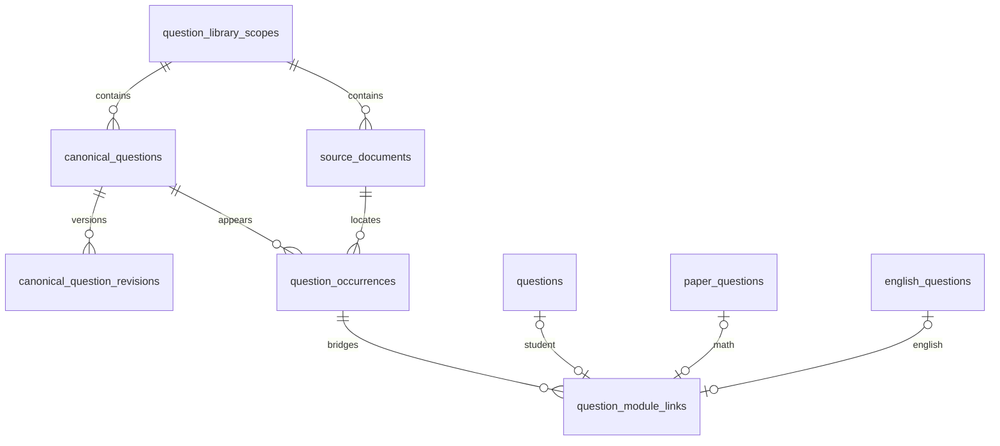

# 阶段 2C：最小 Canonical 题目身份层实施记录

日期：2026-10-07。依据：`docs/统一题库数据模型设计.md` 及阶段 2C 明确授权。

本阶段新增六张空表。旧题目、学习记录、数学套卷和英语完整业务结构继续使用旧表。没有数据回填、双写、API/页面/上传/AI 修改，没有访问远程 D1 或上传业务数据。

## 1. 实施文件与范围

- `db/canonical-schema.ts`：六张表的 Drizzle 定义。
- `db/schema.ts`：仅新增 canonical schema 导出，保留原有英语导出与全部旧表定义。
- `drizzle/0015_canonical_identity_layer.sql`：仅六次 CREATE TABLE 和二十个显式 CREATE INDEX；无 ALTER/DROP/DML。
- `drizzle/meta/0015_snapshot.json`、`drizzle/meta/_journal.json`：Drizzle 生成的 schema 快照与新增第 15 项迁移登记。
- `tests/canonical-schema.test.ts`：全部使用内存合成数据的六项约束/兼容测试。
- `scripts/project-data.mjs`、`scripts/project-data.test.mjs`：将新 schema 文件加入备份与恢复路径白名单，并验证恢复内容。
- `tsconfig.json`：排除 backups 和恢复暂存目录，避免编译历史备份内的 schema。

迁移、指纹比较辅助脚本在项目外 `E:/codex/毕设探索/work/canonical-2c/`，不加入业务入口。验证报告在 `E:/codex/毕设探索/outputs/阶段2C-身份层迁移验证.json`。

未实现：canonical_question_identities、student_question_links、新 taxonomy、分类版本、解析版本、canonical relations、import_jobs/items/attempts。没有添加任何新的业务写入入口。

## 2. 字段与设计依据

下述主键均为 TEXT NOT NULL；由未来调用方提供 UUID，不以 hash 直接生成。时间为 SQLite TEXT，默认 CURRENT_TIMESTAMP；updated_at 需未来调用方在更新时维护，并非自动触发器。

### question_library_scopes：权限及身份候选比较范围

| 字段 | 约束/含义 |
|---|---|
| id | 主键 |
| code | NOT NULL，唯一的范围编码，不用 code 冒充认证权限 |
| name | NOT NULL，展示名 |
| scope_type | authorized_public / teacher_private / student_private / legacy_private |
| kind | 公共类型必须 shared；其他类型必须 private |
| owner_principal_id | 可空；private 且 ownership_status=known 时必须非空非空白 |
| ownership_status | known / legacy_unassigned，默认后者 |
| created_at | 建立时间 |

保留 2B 的 kind、owner、ownership_status，追加本阶段要求的 code/scope_type。已有学生记录不具备认证 owner，不能通过创建 scope 解决权限问题；本阶段没有创建任何 scope，也没有声明题库已获公共发布授权。

### canonical_questions：稳定题目身份

| 字段 | 约束/含义 |
|---|---|
| id、scope_id | 主键及 scopes 外键，RESTRICT |
| subject | math / english / unknown，默认 unknown |
| status | provisional / active / merged / retired，默认 provisional |
| current_revision_id | 可空；与 id 组成同题版本复合外键 |
| redirect_to_id | 可空；同 scope 的 canonical；非空时必须 merged 且不能指向自己 |
| created_at、updated_at | 创建/投影更新时间 |

不保存题号、图片、解析、学生 ID、知识点或难度。创建顺序为身份（current_revision_id=NULL）→版本→更新指针。SQLite 允许 CREATE TABLE 引用稍后创建的表，全部建表完成后才插入；无需关闭外键或重建旧表。

### canonical_question_revisions：内容快照

| 字段 | 约束/含义 |
|---|---|
| id、canonical_question_id | 版本主键及所属题 FK，RESTRICT |
| revision | 正整数，同题唯一 |
| subject | math / english / unknown，版本观察值，默认 unknown |
| education_stage | 可空，来源观察的学段快照，不表示教师已确认分类 |
| original_text、normalized_text | NOT NULL，原文及保守规范文本 |
| normalized_hash | NOT NULL，普通候选索引，不唯一 |
| content_schema_version、normalization_version | NOT NULL，payload/规范规则版本 |
| payload | NOT NULL，合法 JSON TEXT 对象 |
| identity_status | incomplete / ready / needs_review，默认 incomplete |
| supersedes_id | 可空，必须属于同一题且不能指向自己 |
| change_reason | NOT NULL，建立版本原因 |
| created_by | 可空，未来经认证操作者，不虚构旧作者 |
| created_at | 版本生成时间 |

2B 的 content_json/content_hash 分别命名为 payload/normalized_hash；hash 指完整规范内容，而非只取题干。新增 subject/education_stage 是本阶段要求的可检索观察字段；分类推断、教师确认和 taxonomy 版本体系仍未实现。subject 的版本与主体一致性、版本递增/不可覆盖和 supersedes 链无环，未来写入服务必须验证；本阶段无写入业务，也没有声称 SQLite 已禁止 UPDATE 内容。

数学 payload 可以保存题干/选项/必要图形；英语必须含 section 指令、相关 passage 上下文、题干、选项及空位/顺序等必要语义快照。现有 passage/options/answer/evidence/artifact 外键均保留。没有完整上下文时只能 incomplete，不能用于自动合并。

### source_documents：来源载体

| 字段 | 约束/含义 |
|---|---|
| id、scope_id | 主键及资料权限范围 FK |
| source_type | math_paper / english_paper / workbook / student_upload / student_archive / other |
| title | NOT NULL |
| math_paper_id、english_paper_id | 可空、各自非空唯一；最多一个非空，必须匹配 source_type；旧表 FK SET NULL |
| legacy_source_key | 可空，旧载体删除后保留的来源编码 |
| file_storage | r2 / public / external / none，默认 none |
| storage_key | 可空；非 none 时要求非空非空白，语义取决于 storage 类型 |
| original_filename、mime_type | 可空，原件描述 |
| file_hash | 可空，原文件字节摘要，不是题目身份 |
| source_url、license | 可空，不编造来源许可 |
| metadata | JSON TEXT 对象，默认 {} |
| created_at | 纳入来源层的时间 |

file_key_or_path/source_hash 对应 storage_key/file_hash。英语一卷可以有多个 artifact，载体 storage=none 合法；不能任意指定某个答案 PDF 代替整卷。旧 papers/english_papers 完全保留。

### question_occurrences：来源中的具体出现位置

| 字段 | 约束/含义 |
|---|---|
| id、canonical_question_id | 主键、canonical FK RESTRICT |
| content_revision_id | 可空，必须属于本 canonical 的复合 FK |
| source_document_id、source_type | 文档 FK，并以复合 FK 保证来源类型一致 |
| occurrence_key | NOT NULL；同文档内唯一的稳定位置键 |
| question_number | 可空 TEXT，支持 17、18(2)、阅读A-21 |
| page | 可空正整数，仅首页提示 |
| source_locator_json | JSON 对象，默认 {}；完整页范围、regions、section/passage/artifact 定位在此保存 |
| image_key、public_image_path、original_filename | 可空，允许英语无独立 R2 题图 |
| raw_text | 来源原始文本，NOT NULL，默认空字符串 |
| occurrence_hash | 可空，该题图/原区域字节 hash，对应 2B source_hash，不作为内容身份 |
| metadata | JSON 对象，默认 {} |
| parent_occurrence_id | 可空，自引用 RESTRICT，不能指向自己 |
| mapping_status | provisional / confirmed / detached，默认 provisional |
| created_at、updated_at | 时间 |

同 canonical 可有多个来源位置。题号不绑定身份、不全局唯一；page 不能代替多页 regions。源文档 scope 与 canonical scope 允许不同，未来发布/引用流程必须做授权检查。

### question_module_links：旧记录映射

| 字段 | 约束/含义 |
|---|---|
| id | TEXT 主键 |
| module_type | student_question / paper_question / english_question |
| module_record_id | NOT NULL TEXT；整数转十进制，其余保留旧 ID |
| canonical_question_id、occurrence_id | 均 NOT NULL；复合 FK 保证 occurrence 属于该 canonical |
| legacy_student_question_id | 可空 INTEGER FK questions.id，SET NULL |
| legacy_paper_question_id | 可空 TEXT FK paper_questions.id，SET NULL |
| legacy_english_question_id | 可空 TEXT FK english_questions.id，SET NULL |
| observed_source_hash | NOT NULL，旧记录规范快照摘要 |
| mapping_revision | 正整数，默认 1，未来用于并发重绑定 CAS |
| created_at、updated_at | 时间 |

UNIQUE(module_type,module_record_id)；三个类型化旧 FK 分别唯一，最多一个非空，非空时必须与模块/旧 ID 快照一致。三者全空用于保留旧记录永久删除后的快照；检查约束不区分“删除留下的空”与手动插入空，未来创建服务必须要求旧记录存在。

与 2B 的调整：module/legacy_key 改为本阶段规定的 module_type/module_record_id；按要求显式增加 canonical_question_id，但以复合 FK 防止两份身份不一致。occurrence_id 仍遵循 2B 的 NOT NULL：学生上传也需未来登记 student_upload 或 student_archive 载体/位置；本阶段不创建历史映射。人工重绑定必须在同一更新/事务中更改 canonical+occurrence，以 mapping_revision 条件更新并递增。

## 3. 索引清单（20 个显式索引，不含主键内部索引）

| 表 | 普通索引 | 唯一索引 |
|---|---|---|
| scopes | 无 | uq_library_scope_code(code) |
| canonical | idx_canonical_scope(scope_id) | uq_canonical_scope_id(scope_id,id)，复合 FK 父键 |
| revisions | idx_canonical_revision_hash(normalized_hash)；idx_canonical_revision_subject_stage(subject,education_stage) | uq_canonical_revision_number(canonical_question_id,revision)；uq_canonical_revision_id(canonical_question_id,id) |
| documents | idx_source_document_scope(scope_id)；idx_source_document_hash(file_hash) | uq_source_math_paper(math_paper_id)；uq_source_english_paper(english_paper_id)；uq_source_document_type_id(source_type,id) |
| occurrences | idx_occurrence_canonical(canonical_question_id) | uq_occurrence_source_key(source_document_id,occurrence_key)；uq_occurrence_canonical_id(canonical_question_id,id) |
| links | idx_module_canonical(canonical_question_id) | uq_module_record(module_type,module_record_id)；uq_module_student_question、uq_module_paper_question、uq_module_english_question（各旧 FK） |

同题版本、同文档位置索引的最左列已经支持所属 canonical/document 查询，未重复建立单列索引。subject+education_stage 用于组合过滤；只有 education_stage 的查询不保证利用此索引。未提前增加更多索引。

normalized_hash 无全局或同 scope 唯一性：重复版本可保留，不同 scope 可保存同 hash，当前仅用于候选。未来 identities 表才处理 scope+身份规则版本+完整 payload 校验后的精确身份登记；相似/变式题不能据此合并。

## 4. 外键、删除与循环

共 19 个外键约束（包含复合外键）。scopes→canonical/documents、canonical→revisions/occurrences/links、documents→occurrences 和 occurrences→links 都采取 RESTRICT。选中 current revision 不能被删除；supersedes 引用的版本不能被删除。redirect 限制同 scope；parent/supersedes 只禁止自引用，跨节点循环须未来服务验证。

旧 questions/paper_questions/english_questions 删除只 SET NULL 类型化桥接 FK，保留旧 ID 快照，不阻止原业务删除。旧 papers/english_papers 删除只 SET NULL 来源桥接 FK。没有向旧表添加外键或改变旧级联规则。R2 删除不由 SQLite 外键控制，未来接入前仍需解决旧删除 API 对文件生命周期的影响。



## 5. 迁移执行与数据验证

迁移 SQL 来自现有 Drizzle generator；静态检查只有新增语句，额外加 IF NOT EXISTS 使同一兼容 schema 可重复执行。它不是 schema 漂移修复工具：已有同名但结构不一致的表/索引不能靠 IF NOT EXISTS 校验，部署前必须比对快照。本次辅助程序在首次应用前拒绝六张新表已有同名对象。

实际执行顺序：

1. 完整备份成功：`backups/2026-10-07T04-48-03-969Z-5f465d2a`，原业务表 26、R2 35，全部文件 hash/SQLite 完整性/FK 校验通过。
2. 恢复到 `E:/codex/毕设探索/work/canonical-2c/restored-project`，先应用 0015。
3. 开启 foreign_keys，BEGIN IMMEDIATE，保留旧 sqlite_master 定义、旧各表行数及逐行数据 hash。在事务内验证旧数据一致、新表全空、integrity_check/FK_check，再重复执行同一 SQL 确认 schema/记录不变。
4. 独立副本通过后，检查本地服务停止和 SQLite/WAL/SHM 无占用，与备份来源指纹一致。在当前本地 D1 执行相同事务；没有使用 Wrangler 连接远程、没有执行旧迁移历史。
5. 事务提交后再次只读比较旧数据和所有其他资产指纹，R2/英语/其他业务文件字节一致。

本地 D1：`.wrangler/state/v3/d1/miniflare-D1DatabaseObject/faaf2b0445ab934c3aac48ddf0cdfade8f9bac050be98993748742cdd2cb05fb.sqlite`。

原有 26 张业务表及 `_cf_METADATA`/`sqlite_sequence` 共 28 张旧表的定义与数据 hash 一致。关键行数（含原有软删除记录）：students 1，questions 8，papers 3，paper_questions 24，english_questions 540。新六表各 0 条，业务表总数从 26 到 32。R2 对象 35→35，映射及二进制字节一致。

本次直接在已核验的本地 SQLite 应用单个 SQL，没有新增或修改运行时迁移账本表。Drizzle journal 表示源码迁移顺序，不证明线上已应用；未来接入部署工具需先对齐实际 schema/迁移登记，禁止在当前库盲目重放 0000–0014。

验证过程的两个修正如实记录：提交后的报告脚本误按数组处理对象式指纹，报告生成失败，事务内的旧数据/完整性/新表空校验均已通过；随后独立只读核验完成并生成最终报告。原备份元数据白名单遗漏新 canonical-schema.ts，业务数据备份完整；补齐白名单并保留原备份，另从原备份恢复旧数据库生成包含新 schema 元数据的完整回滚包。该包创建于迁移后，但数据库内容确实为迁移前 26 表，不伪称它在迁移前创建。

恢复副本首次重新备份时，SQLite 只读打开 WAL 模式快照产生空 WAL/SHM，严格文件指纹检查报告失败（失败目录 `2026-10-07T04-50-10-980Z-7dc78379`，status=failed，不作为回滚包）。确认没有行数据变化后重新备份；保留失败记录，没有放宽校验。

最终成功备份：补齐元数据的迁移前状态回滚包为 `backups/2026-10-07T04-50-49-105Z-93ceb53f`（26 张业务表）；迁移后包为 `backups/2026-10-07T04-50-55-001Z-019db4d3`（32 张）。两包完整校验通过；前者进一步恢复到 `E:/codex/毕设探索/work/canonical-2c/complete-rollback-restore-check`，验证 canonical schema 文件完整恢复。另逐表比较 0014/0015 Drizzle 快照，原有 26 张表定义完全一致。

## 6. 自动检查结果

- 新 schema 六项测试通过；覆盖六表存在、真实全历史迁移在空库可执行、复合 FK、删除行为、scope/重复 hash、多版本、多位置、三类旧 ID、唯一映射/CAS 重绑定、旧删除快照、重复应用、SQLite/FK 检查。
- 与已有 paper/learning/interventions/diagnostic-links 测试一并运行，32/32 通过。测试均在内存或隔离目录使用合成数据，没有对真实业务表插入测试记录。
- 备份恢复回归 4/4 通过，额外确认 canonical-schema.ts 在独立恢复目录正确恢复。
- TypeScript 全项目 `tsc --noEmit --pretty false` 通过。备份目录已排除。
- 本次相关 tracked 文件 git diff --check 通过。没有启动开发服务、运行浏览器或调用 AI。

## 7. 回滚方法与边界

优先停止项目写入，核对 `outputs/阶段2C-身份层迁移验证.json` 中的 backup / completedPreMigrationBackup / postMigrationBackup 路径，使用阶段 2A 工具先 --verify-only，然后恢复到一个全新的独立目录验证。完整迁移前回滚包包含 26 张旧业务表、R2 和英语数据及补齐的 schema 元数据；迁移后备份包含 32 张表。保留所有成功备份及失败记录。

```powershell
node scripts/restore-project-data.mjs --backup="<completedPreMigrationBackup>" --verify-only
node scripts/restore-project-data.mjs --backup="<completedPreMigrationBackup>" --target="E:\codex\毕设探索\work\rollback-check-2c"
```

只有核验目标、停写且用户决定恢复时，才对真实项目使用 --force。工具先创建当前状态完整安全备份，默认拒绝覆盖；本阶段从未对真实项目执行恢复覆盖。整包恢复会回到备份时点，不能覆盖随后产生的新学生记录；先评估差异/保留新数据。schema、journal 和业务文件需同步核对：恢复旧数据库不等于源码自动降级。本包 schema 描述新表尚未应用的合法状态，若要恢复旧运行时代码还需保留/还原本阶段源码改动。

不提供自动 down migration。虽然空表理论上可逻辑删除，真实数据环境优先已验证备份与明确恢复流程，不能随意 DROP，特别是后续这些表有数据之后。

## 8. 后续风险与阶段 2D 最小范围

1. 权限风险：scope 是结构，不是已实现的授权。旧学生 owner 不明确，禁止跨 scope 自动合并或把私人 R2 文件直接公开。
2. 身份及生命周期风险：完整英语上下文/图片版本、版本不可覆盖、指针更新审计、关系链无环、R2 文件删除保留均需后续服务实现；hash 只是候选。
3. 运维风险：当前本地单 SQL 的已应用状态与远程迁移账本不能混同。再次部署前核验 0015、旧迁移登记和完整备份；严格备份遇到首次空 WAL 生成可能拒绝，需停写核查后重试。

建议 2D 只实现**只读映射预览/审计工具**：从独立恢复副本抽取少量学生/数学套卷/英语题，生成候选 scope、内容 payload、来源/occurrence、旧模块映射和缺失项报告；不自动写入、不回填、不双写、不调用 AI。先人工核对完整上下文、授权和生命周期规则，再另行批准最小人工写入服务。
